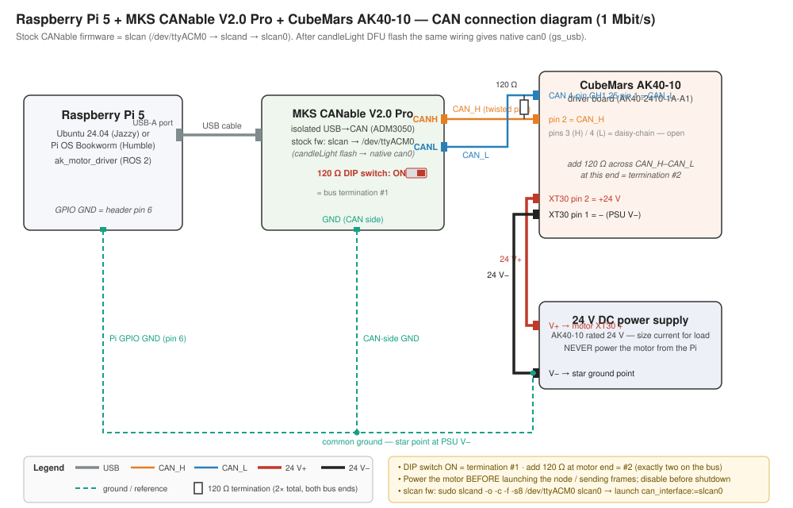

# Raspberry Pi 5 + AKCAN40 + AK40-10 with ROS 2

Complete setup guide for running the `ak_motor_driver` package on a **Raspberry Pi 5**
with the CubeMars **AKCAN40** USB-to-CAN adapter driving an **AK40-10** actuator.

The Raspberry Pi 5 has **no on-board CAN controller** (the Broadcom BCM2712 SoC does not
include one). The AKCAN40 dongle is a `gs_usb`-compatible USB-CAN adapter, and **both**
supported Pi OS options ship the driver as a loadable module
(`CONFIG_CAN_GS_USB=m` in the Ubuntu `linux-raspi` kernel and in the Raspberry Pi OS
`bcm2712_defconfig`), so the dongle simply enumerates as `can0` — no out-of-tree kernel
module build is needed (unlike Jetson Orin, see
[README § Jetson Orin](../README.md#jetson-orin-tegra-kernel)).

| OS on the Pi 5 | ROS 2 | Status |
|---|---|---|
| Ubuntu Server/Desktop 24.04 arm64 | Jazzy (Tier-1 apt binaries) | Recommended — § 3 onward |
| Raspberry Pi OS Bookworm (Debian 12) arm64 | Humble (or any working install) | Supported — the driver builds unmodified; see § 9. The CAN steps (§ 6) are identical. |

```
   USB (stock slcan fw → /dev/ttyACM0 → slcan0 · candleLight fw → native can0)
  ┌───────────────┐        ┌──────────────────────────┐        ┌─────────────────────┐
  │ Raspberry Pi 5│───────►│ MKS CANable V2.0 Pro     │        │ AK40-10 driver board│
  │               │        │  CANH ───────────────────┼───────►│ CAN pin 2 (CAN_H)   │
  │               │        │  CANL ───────────────────┼───────►│ CAN pin 1 (CAN_L)   │
  │               │        │  120R DIP switch = ON    │        │ CAN pins 3/4: open  │
  │               │        │        (termination #1)  │        │ XT30 2 = +24 V  ◄───┼── V+  ┌──────────┐
  └──────────────┘        ──────────┬───────────────┘        │ XT30 1 = −      ◄───── V− ─│ 24 V PSU │
         │ GPIO GND (pin 6)           │ CAN-side GND           └─────────────────────┘       └──────────┘
         └──────────────┬─────────────┘                                     ▲         ▲
                        └──────── common GND: star point at PSU V− ─────────┴─────────
                          + add 120R across CAN_H–CAN_L at motor end (termination #2)
```

A full vector version of this diagram is at
[`doc/media/connection_diagram_pi5_canable_ak40.svg`](media/connection_diagram_pi5_canable_ak40.svg).

---

## 1. What you need

| Item | Notes |
|---|---|
| Raspberry Pi 5 (4 GB or 8 GB) | arm64. A Pi 4 also works with the same steps. |
| Official 27 W USB-C PSU (5 V / 5 A PD) | Undervoltage causes USB dropouts → the CAN dongle resets. |
| Good microSD (A2) or NVMe HAT | ROS 2 + colcon build is I/O heavy. |
| CubeMars AKCAN40 USB-CAN adapter | `gs_usb` / candleLight-class, 1 Mbps — matches the AK40-10 CAN bus rate. Any SocketCAN USB adapter works: CANable 2.x, **MKS Makerbase CANable V2.0 / V2.0 Pro** (isolated), PCAN-USB, … **Note:** MKS CANable boards ship with *slcan* (serial) firmware — see § 6.1. |
| CubeMars AK40-10 actuator + driver board | With the AK V2.0 wiring pack (power + CAN + serial cables). |
| 24 V DC power supply for the motor | AK40-10 rated voltage is 24 V. Size the current for your load; **never** power the motor from the Pi. |
| CAN termination | Two 120 Ω terminations total on the bus (see § 2). |

## 2. Wiring



| From | Connector / pin | Signal | To |
|---|---|---|---|
| Raspberry Pi 5 | USB-A port (any) | USB | CANable V2.0 Pro USB plug |
| MKS CANable V2.0 Pro | CAN terminal **CANH** | CAN high | AK CAN harness `CAN_H` = driver-board CAN connector **pin 2** (or 3) |
| MKS CANable V2.0 Pro | CAN terminal **CANL** | CAN low | AK CAN harness `CAN_L` = driver-board CAN connector **pin 1** (or 4) |
| MKS CANable V2.0 Pro | CAN terminal **GND** (isolated side) | CAN-side reference | 24 V PSU **V−** (star ground) |
| MKS CANable V2.0 Pro | **120 Ω DIP switch → ON** | bus termination #1 | — |
| AK40-10 driver board | CAN 4-pin GH1.25, pins 3/4 | duplicate H/L for daisy-chaining | **leave open** |
| AK40-10 driver board | XT30 power, **pin 2** | +24 V | PSU **V+** |
| AK40-10 driver board | XT30 power, **pin 1** | − | PSU **V−** |
| Raspberry Pi 5 | GPIO header **pin 6** (GND) | reference | PSU **V−** (same star point) |
| *(add)* | across `CAN_H`–`CAN_L` at the motor end | 120 Ω resistor | bus termination #2 |

1. **CAN:** CANable `CANH` → harness `CAN_H`, `CANL` → `CAN_L`. Pinout per the driver
   manual (also in [`doc/`](.) PDF): 4-pin GH1.25 = 1 `CAN_L`, 2 `CAN_H`, 3 `CAN_H`,
   4 `CAN_L`. If in doubt, swap H/L and re-test — a swapped pair simply produces no
   frames, nothing breaks.
2. **Termination:** the CAN bus needs **120 Ω at each physical end**. On the CANable
   V2.0/Pro set the on-board **120 Ω DIP slide switch to ON** (termination #1). The
   AK40-10 driver board does not terminate the bus, so add a 120 Ω resistor across
   `CAN_H`–`CAN_L` at the motor end (termination #2). Wrong termination shows up as
   constant error frames / BUS-OFF.
3. **Ground:** tie Pi GPIO GND (pin 6) **and** the CANable CAN-side GND to the PSU V−
   at one star point. Separate supplies without a common reference cause flaky CAN
   and can damage ports.
4. **Power:** motor → 24 V PSU via the XT30 power cable. Pi → its own 5 V USB-C PSU.
   Power the motor **before** launching the node or sending CAN frames.

## 3. Flash Ubuntu Server 24.04 LTS (64-bit)

> Already running Raspberry Pi OS with a working ROS 2 (e.g. Humble)? Skip to § 9 — only
> this section and § 4 are Ubuntu-specific.

Use **Ubuntu 24.04 (Noble) arm64** — it is the Tier-1 platform for **ROS 2 Jazzy**, so
you install ROS from apt binaries. (Raspberry Pi OS also works for CAN, but has no
official ROS 2 binaries — see § 9.)

1. Install [Raspberry Pi Imager](https://www.raspberrypi.com/software/) on your PC.
2. Choose device **Raspberry Pi 5** → OS **Other general-purpose OS → Ubuntu →
   Ubuntu Server 24.04.2 LTS (64-bit)**. (Ubuntu *Desktop* 24.04 also works if you
   want a monitor/GUI; Server is lighter for a headless robot.)
3. In Imager's **OS customization** (gear icon): set hostname (e.g. `ak40pi`), enable
   SSH with your public key or a password, set Wi-Fi/ethernet, locale, and your user.
4. Flash, boot the Pi, and log in over SSH:

```bash
ssh <user>@ak40pi.local
```

> The Pi 5 needs Ubuntu 23.10 or newer (older kernels lack BCM2712 support), so
> ROS 2 Humble/Ubuntu 22.04 is not a practical target on this board. Jazzy is the
> right pairing.

## 4. Install ROS 2 Jazzy and CAN tools

```bash
sudo apt update && sudo apt upgrade -y
sudo apt install -y software-properties-common curl
sudo add-apt-repository universe

# ROS 2 apt repository (official Jazzy instructions)
sudo curl -sSL https://raw.githubusercontent.com/ros/rosdistro/master/ros.key \
  -o /usr/share/keyrings/ros-archive-keyring.gpg
echo "deb [arch=$(dpkg --print-architecture) signed-by=/usr/share/keyrings/ros-archive-keyring.gpg] http://packages.ros.org/ros2/ubuntu $(. /etc/os-release && echo $UBUNTU_CODENAME) main" \
  | sudo tee /etc/apt/sources.list.d/ros2.list > /dev/null

sudo apt update
sudo apt install -y ros-jazzy-ros-base ros-dev-tools   # headless; use ros-jazzy-desktop if you want rqt/foxglove tooling
sudo apt install -y can-utils                          # candump, cansend, ip link CAN support

echo "source /opt/ros/jazzy/setup.bash" >> ~/.bashrc
source ~/.bashrc
```

Verify: `ros2 --help` prints usage, and `candump --help` exists.

## 5. Get and build the driver

```bash
mkdir -p ~/ak40_ws/src && cd ~/ak40_ws/src
git clone https://github.com/pioneeradfa/AK40-10-ROS2-Bridge.git ak_motor_driver

cd ~/ak40_ws
# All package deps (rclcpp, sensor_msgs, std_msgs, std_srvs) are already in ros-jazzy-ros-base.
# Optional, if you want rosdep to verify: sudo apt install python3-rosdep && sudo rosdep init && rosdep update
# rosdep install --from-paths src --ignore-src -r -y
colcon build --packages-select ak_motor_driver
echo "source ~/ak40_ws/install/setup.bash" >> ~/.bashrc
source ~/.bashrc
```

The package is plain C++17 / `ament_cmake` — a native arm64 build on the Pi 5 takes a
few minutes. No cross-compilation needed.

## 6. Bring up the CAN interface (AKCAN40 → `can0`)

Plug the AKCAN40 into any Pi 5 USB port, power the motor, then from the repo:

```bash
sudo ./scripts/setup_can_pi5.sh              # configure can0 @ 1 Mbps
sudo ./scripts/setup_can_pi5.sh --persist    # one-time: also auto-configure on every boot/hotplug
```

The script loads `gs_usb`, waits for the interface to enumerate, and runs:

```bash
sudo ip link set can0 down
sudo ip link set can0 type can bitrate 1000000
sudo ip link set can0 txqueuelen 1000
sudo ip link set can0 up
ip link show can0        # expect: state UP, bitrate 1000000
```

`--persist` installs `/etc/modules-load.d/gs_usb.conf` and a udev rule
(`/etc/udev/rules.d/99-akcan40-can.rules`) that brings any `can*` interface up at
1 Mbps whenever it appears — after this you never run the script again, even if the
dongle is replugged.

### 6.1 First, check how your adapter enumerates (MKS CANable firmware note)

**MKS Makerbase CANable V2.0 / V2.0 Pro boards ship with *slcan* (serial) firmware**, so
they appear as a serial port, not `can0`, until you flash candleLight firmware. Identify
what you have:

```bash
lsusb                                 # candleLight/gs_usb firmware → 1d50:606f; MKS stock slcan → 16d0:117e; ST serial → 0483:5740
ls /dev/ttyACM* /dev/ttyUSB* 2>/dev/null
ip -br link show | grep -i can        # can0 listed?
dmesg | tail -20                      # look for "gs_usb" or "cdc_acm"
```

- **`can0` exists** (dmesg shows `gs_usb`) → candleLight-class firmware → continue § 6.2.
- **Only `/dev/ttyACM0` exists** → stock slcan firmware → either run it through `slcand`
  right now (§ 10 fallback — perfectly fine at 1 Mbps), or flash candleLight firmware
  for native `can0` (§ 10 has links). With `slcand` your interface is `slcan0` and the
  loopback test in § 6.2 does not apply (slcan sets bitrate via the serial `S8` command,
  not netlink) — go straight to § 6.3.

Real-world example — MKS CANable V2.0 Pro with factory firmware, verified on a
Raspberry Pi 5:

```console
$ lsusb
Bus 001 Device 005: ID 16d0:117e MCS CANable2 b158aa7 github.com/normaldotcom/canable2.git
```

`16d0:117e "MCS CANable2"` (the `b158aa7` suffix is the firmware build commit) means
**slcan firmware** → serial `/dev/ttyACM0` → use the slcan path (§ 10a) now, or flash
candleLight (§ 10b) for native `can0` later.

### 6.2 Test the adapter alone — loopback (no motor, no wiring needed)

Loopback keeps every frame inside the adapter/driver — nothing hits the wire and no bus
ACK is needed, so this validates USB + driver + SocketCAN on a bare desk. **gs_usb/canX
interfaces only:**

```bash
sudo ip link set can0 down
sudo ip link set can0 type can bitrate 1000000 loopback on
sudo ip link set can0 up

candump can0                      # terminal A
cansend can0 123#DEADBEEF         # terminal B
# terminal A must show:   can0  123   [8]  DE AD BE EF 00 00 00 00

# restore normal mode before connecting the motor:
sudo ip link set can0 down
sudo ip link set can0 type can bitrate 1000000 loopback off
sudo ip link set can0 up
```

### 6.3 Test the full bus — adapter + motor (no ROS needed)

Wire CAN_H/CAN_L per § 2 (termination fitted), power the motor from its 24 V supply,
bring the interface up (§ 6), then:

```bash
# terminal A — watch the bus
candump can0            # or: candump slcan0

# terminal B — ask the motor to enter MIT mode (frame from the driver manual § 5.3:
# CAN ID = motor ID (default 1), data FF FF FF FF FF FF FF FC)
cansend can0 001#FFFFFFFFFFFFFFFC
```

**Pass criterion:** terminal A immediately shows a response frame on ID `001` whose
`data[0]` echoes the motor ID:

```
can0  001   [8]  01 7F E2 80 00 18 5A 00
     │ │          │ └────┬────┘ │  │  └─ data[7]: error flags
     │ │          │      │      │  └──── data[6]: temperature (raw − 40 °C)
     │ │          │      │      └─────── data[4..5]: current/torque raw
     │ │          │      └────────────── data[1..3]: position/velocity raw
     │ │          └───────────────────── data[0] = 0x01 → motor ID echo ✓
     │ └──────────────────────────────── motor responds on 0x00 + motor ID
```

Then leave MIT mode again:

```bash
cansend can0 001#FFFFFFFFFFFFFFFD
```

> **Safety notes for § 6.3**
> - **Do not send `001#FFFFFFFFFFFFFFFE`** during a connection test — that is the
>   *set-zero-position* frame and it overwrites the encoder zero stored in motor flash.
> - Entering MIT mode alone cannot move the motor (motion needs a packed control frame
>   with kp/kd), but keep hands clear of the shaft anyway and send the `…FD` exit frame
>   when finished.
> - No response at all → work down § 10: motor power, CAN_H/CAN_L swap, termination
>   (2 × 120 Ω total), common ground, and `ip -details -statistics link show can0`
>   (rising TX errors / bus-off = electrical problem, not software).

### 6.4 Test through ROS 2

```bash
# terminal A — raw bus view
candump can0

# terminal B
ros2 launch ak_motor_driver ak_motor.launch.py can_interface:=can0   # or slcan0
ros2 service call /ak_motor_node/enable std_srvs/srv/Trigger
ros2 topic hz /ak_motor_node/joint_state     # ≈ poll_rate_hz (100 Hz) → full stack OK
ros2 topic echo /ak_motor_node/joint_state --once
ros2 service call /ak_motor_node/disable std_srvs/srv/Trigger        # ALWAYS disable after
```

MIT mode is request-response: terminal A stays quiet until `enable`, then shows one
command + one feedback frame per poll cycle. `joint_state` at ~100 Hz with plausible
position/temperature proves the Pi ↔ CANable ↔ AK40-10 path end-to-end.

## 7. Launch and run the motor

```bash
source ~/ak40_ws/install/setup.bash

# basic driver node
ros2 launch ak_motor_driver ak_motor.launch.py can_interface:=can0

# or the GUI-facing cable control node
ros2 launch ak_motor_driver cable_control.launch.py can_interface:=can0
```

`can0` is already the launch default on the Pi (the dongle claims `can0` just like on
an Ubuntu laptop — the Orin's `can1` does not apply here), so the argument can be
omitted.

Then follow the normal **[Operating sequence](../README.md#operating-sequence)** in the
README: set encoder zero (while disabled) → set gains → publish `~/command` →
`enable` → move → `disable` before stopping the node.

Quick smoke test:

```bash
# terminal 1
ros2 launch ak_motor_driver ak_motor.launch.py
# terminal 2
ros2 service call /ak_motor_node/enable std_srvs/srv/Trigger
ros2 topic pub --rate 50 /ak_motor_node/command sensor_msgs/msg/JointState \
  "{name: ['ak40_10'], position: [0.5], velocity: [0.0], effort: [0.0]}"
ros2 topic echo /ak_motor_node/joint_state        # feedback flowing → CAN link OK
ros2 service call /ak_motor_node/disable std_srvs/srv/Trigger   # ALWAYS disable when done
```

## 8. Optional: auto-start the node at boot

With `setup_can_pi5.sh --persist` done (§ 6), CAN is up before the node starts.
Add a systemd unit if you want the driver to run headless at boot:

```bash
sudo tee /etc/systemd/system/ak_motor.service > /dev/null << 'EOF'
[Unit]
Description=AK40-10 ROS 2 driver (ak_motor_driver)
After=network-online.target
Wants=network-online.target

[Service]
Type=simple
User=<your_user>
ExecStart=/bin/bash -lc 'source /opt/ros/jazzy/setup.bash && source /home/<your_user>/ak40_ws/install/setup.bash && exec ros2 launch ak_motor_driver cable_control.launch.py can_interface:=can0'
# On Raspberry Pi OS with Humble, source your Humble install instead, e.g. /opt/ros/humble/setup.bash
Restart=on-failure
RestartSec=5

[Install]
WantedBy=multi-user.target
EOF

sudo systemctl daemon-reload
sudo systemctl enable --now ak_motor.service
journalctl -u ak_motor -f        # live logs
```

> **Safety:** the node does not enable the motor by itself (enable is a service call),
> and `ak_motor_cable_control_node` sends `exit_mit_mode` on startup to clear any armed
> state — so auto-start is safe. Still, review the
> [Safety](../README.md#safety) section before running a rig unattended.

## 9. Raspberry Pi OS (Debian Bookworm) — e.g. with ROS 2 Humble

Raspberry Pi OS is **Tier 3** for ROS 2 (no official apt binaries), but it is a fully
working setup:

- **CAN side — identical to Ubuntu.** The Pi OS kernel (6.6.y, `bcm2712_defconfig`)
  includes `gs_usb`, `slcan`, and `mcp251x(fd)` as modules, so the AKCAN40 appears as
  `can0` and § 6 applies as-is:

  ```bash
  sudo apt install -y can-utils
  sudo ./scripts/setup_can_pi5.sh --persist   # once; or without --persist per reboot
  ```

- **Driver side — Humble-compatible.** `ak_motor_driver` only needs `rclcpp`,
  `sensor_msgs`, `std_msgs`, `std_srvs` (C++17, `ament_cmake`) — it builds unmodified on
  ROS 2 Humble and newer. If you already have Humble sourced (`echo $ROS_DISTRO` →
  `humble`), just build the package against it.

**Quickstart from a GitHub ZIP download** (the ZIP unpacks as a loose folder, e.g.
`~/AK40-10-ROS2-Bridge-master` — colcon needs it inside a workspace `src/`):

```bash
sudo apt install -y build-essential python3-colcon-common-extensions can-utils

mkdir -p ~/ros2_ws/src
mv ~/AK40-10-ROS2-Bridge-master ~/ros2_ws/src/ak_motor_driver
cd ~/ros2_ws

source /opt/ros/humble/setup.bash        # or wherever your Humble install lives
colcon build --packages-select ak_motor_driver

echo "source ~/ros2_ws/install/setup.bash" >> ~/.bashrc
source ~/ros2_ws/install/setup.bash

sudo ~/ros2_ws/src/ak_motor_driver/scripts/setup_can_pi5.sh
ros2 launch ak_motor_driver cable_control.launch.py can_interface:=can0
```

> **Note:** the Pi 5 additions (`scripts/setup_can_pi5.sh`, this guide) live on the repo
> branch — a ZIP of `master` may not contain them yet. Clone instead of using the ZIP, or
> use the manual `ip link` commands in § 6 / README until the branch is merged.

**If you don't have ROS 2 on Pi OS yet**, pick one:

- **Docker (easiest):** run the arm64 `ros:humble` or `ros:jazzy` image with host
  networking so DDS and SocketCAN work directly:

  ```bash
  sudo apt install docker.io
  sudo usermod -aG docker $USER   # re-login after this

  # create the workspace on the host first (§5, clone step only — no ROS install needed)
  mkdir -p ~/ak40_ws/src && cd ~/ak40_ws/src
  git clone https://github.com/pioneeradfa/AK40-10-ROS2-Bridge.git ak_motor_driver

  docker run -it --rm --network host --privileged \
    -v $HOME/ak40_ws:/ws ros:humble bash
  # inside the container:
  cd /ws && colcon build --packages-select ak_motor_driver && source install/setup.bash
  ros2 launch ak_motor_driver cable_control.launch.py can_interface:=can0
  ```

- **Build from source:** follow the
  [ROS 2 Jazzy source install](https://docs.ros.org/en/jazzy/Installation/Alternatives/Ubuntu-Development-Setup.html)
  on the Pi (works, but slow — order of an hour or more).

## 10. Troubleshooting

| Symptom | Cause / fix |
|---|---|
| `lsusb` doesn't list the adapter | USB cable/power issue. Try another port; avoid unpowered hubs. |
| Adapter in `lsusb` but no `can0` | `sudo modprobe gs_usb`; check `dmesg \| tail -30`. If `lsusb` instead shows `16d0:117e "MCS CANable2"` (MKS stock firmware) or a `/dev/ttyACM0` appears, it is serial (slcan) — use `slcand` per the fallback below, or flash candleLight firmware. |
| `RTNETLINK answers: Operation not supported` on `ip link set can0 type can` | The interface isn't a CAN device (wrong name picked, or serial firmware). Check `ip -details link`. |
| Node runs but no `joint_state` feedback | In another terminal: `candump can0`. No frames at all → check CAN_H/CAN_L swap, termination (2 × 120 Ω), common ground, motor power. Feedback only flows **after** `enable` (MIT mode is request-response). |
| Interface goes BUS-OFF (`ip -details link show can0` shows `bus-off`) | Usually the node transmitting before the motor is powered (no ACK). Recover: `sudo ip link set can0 down && sudo ip link set can0 up`. Power the motor first. |
| `Resource temporarily unavailable` / dropped frames at 100 Hz | Small TX queue: `sudo ip link set can0 txqueuelen 1000` (the setup script does this). Also check the PSU is 5 V/5 A — USB brownouts reset the dongle. |
| `candump` shows constant error frames | Termination wrong (need exactly 2 × 120 Ω), or bitrate mismatch (must be 1 Mbps). |
| Pi reboots randomly under motor load | Motor PSU and Pi PSU must be separate with common ground; back-EMF/current spikes on a shared supply brown out the Pi. |
| ROS 2 topics not visible from your laptop | Same `ROS_DOMAIN_ID` on both machines, same subnet, multicast allowed. Wi-Fi power saving adds latency: `sudo iw dev wlan0 set power_save off` (or use wired Ethernet). |

**slcan path — stock firmware of MKS Makerbase CANable V2.0 / V2.0 Pro.** If the adapter
enumerates as a serial device (`/dev/ttyACM0` or `/dev/ttyUSB0`) instead of `can0`, it is
running slcan firmware. Two options:

**(a) Run it as-is via `slcand`** (fine at 1 Mbps; interface name `slcan0`). The setup
script detects a serial adapter and does this automatically, so you can just re-run it:

```bash
sudo ./scripts/setup_can_pi5.sh        # finds /dev/ttyACM0 → brings up slcan0 itself
```

or manually:

```bash
sudo apt install -y can-utils
sudo slcand -o -c -f -s8 /dev/ttyACM0 slcan0   # -s8 = 1 Mbit/s, -f clears error flags
sudo ip link set slcan0 txqueuelen 1000
sudo ip link set slcan0 up
ip -details link show slcan0                   # state UP

ros2 launch ak_motor_driver cable_control.launch.py can_interface:=slcan0
# stop it later with: sudo pkill slcand
```

Persist across reboots with a systemd unit (the § 6 udev rule only covers native `can*`
interfaces). `-F` keeps slcand in the foreground for systemd; the wrapper waits for
`slcan0` to appear before bringing it up:

```bash
sudo tee /etc/systemd/system/slcan0.service > /dev/null << 'EOF'
[Unit]
Description=slcan0 SocketCAN interface for MKS CANable (slcan firmware on /dev/ttyACM0)

[Service]
Type=simple
ExecStart=/bin/bash -c 'slcand -F -o -c -f -s8 /dev/ttyACM0 slcan0 & SLPID=$!; for i in $(seq 1 30); do ip link show slcan0 >/dev/null 2>&1 && break; sleep 0.5; done; ip link set slcan0 txqueuelen 1000; ip link set slcan0 up; wait $SLPID'
ExecStopPost=-/bin/bash -c 'ip link set slcan0 down || true'
Restart=on-failure
RestartSec=2

[Install]
WantedBy=multi-user.target
EOF
sudo systemctl daemon-reload
sudo systemctl enable --now slcan0.service
ip -details link show slcan0        # state UP after boot / replug
```

> If the board ever enumerates as `/dev/ttyACM1` (other USB-serial devices present),
> point the unit at the stable path instead: `ls -l /dev/serial/by-id/` and use the
> `usb-MCS_CANable2*-if00` symlink.

**(b) Flash candleLight firmware (recommended long-term)** — the board then enumerates
as native gs_usb `can0` (§ 6 applies verbatim), with better behaviour under bus load:

- Firmware + DFU flashing instructions: <https://github.com/makerbase-mks/CANable-MKS>
  (`Firmware/` folder; enter DFU mode with the BOOT button, flash with `dfu-util`).
- For the **isolated V2.0 Pro** specifically (STM32G431 + ADM3050), see the build/flash
  notes in <https://github.com/SebKuzminsky/mks-canable-2.0-pro>.
- Verify after flashing: `lsusb` shows `1d50:606f`, `dmesg` shows `gs_usb`, `can0`
  appears.

## 11. Performance notes

- The 100 Hz poll loop (`poll_rate_hz`) uses a tiny fraction of one Pi 5 core; the
  cable-control + torque-controller + waveform-reference stack runs comfortably.
- For `ros2 bag record` calibration runs, write bags to a fast card/NVMe and keep
  Wi-Fi power-save off (or record over wired Ethernet).
- Keep the Pi cool (active cooler or case fan) — sustained CAN + DDS + builds throttle
  a bare Pi 5.
